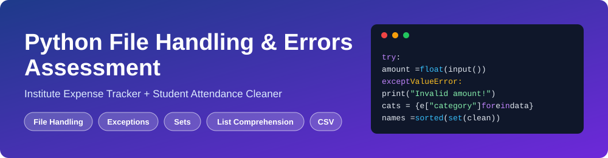
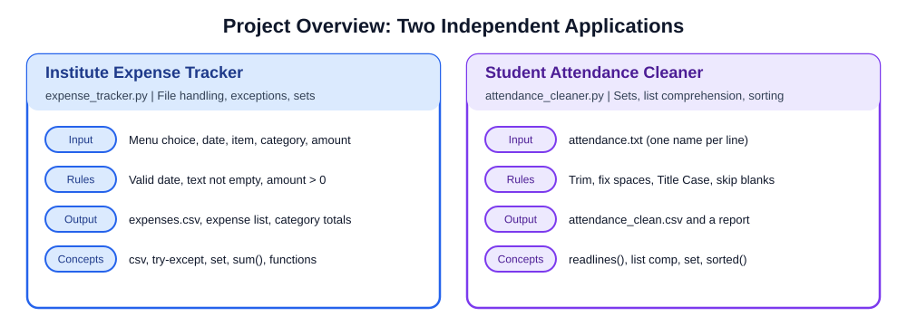
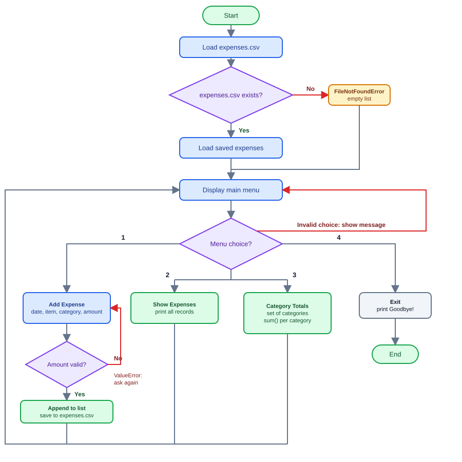
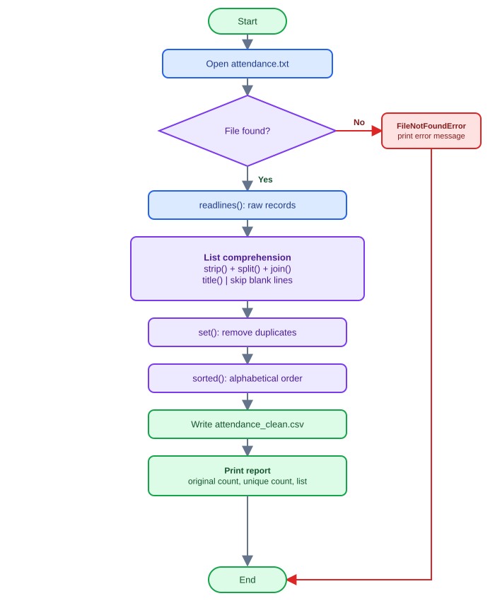
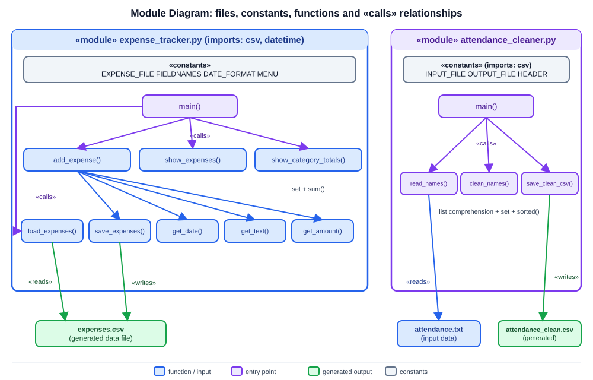

<p align="center"></p>

# Python File Handling & Errors Assessment

Two independent Python programs for a training institute: an **Expense Tracker** that stores data in CSV, and an **Attendance Cleaner** that tidies a student list. Both use only built-in Python modules.

**Live Demo:** [Try both programs in your browser](https://syedamaheen05.github.io/python-files-errors-assessment/) (the page repeats the Python logic; the real programs run locally).

## 1. Project Overview

| Task | File | Topic |
|---|---|---|
| 1. Institute Expense Tracker | `expense_tracker.py` | File handling, exception handling, sets, CSV |
| 2. Student Attendance Cleaner | `attendance_cleaner.py` | Text and CSV files, list comprehension, sets, sorting |

<p align="center"></p>

## 2. Folder Structure

```text
python-files-errors-assessment/
├── expense_tracker.py        # Task 1: Institute Expense Tracker
├── attendance_cleaner.py     # Task 2: Student Attendance Cleaner
├── attendance.txt            # Input: original attendance records             
├── attendance_clean.csv      # Output: generated by the attendance cleaner
│   index.html            # Live demo page (GitHub Pages)
├── assets/                   # Images used in this README
│   ├── banner.svg
│   ├── overview.svg
│   ├── expense_flow.svg
│   ├── attendance_flow.svg
│   └── uml_diagram.svg
└── README.md
```

`expenses.csv` is created when the first expense is saved and `attendance_clean.csv` when the cleaner runs. The `assets/` folder only holds images and the `docs/` folder only holds the demo page; both are extra folders that do not change the required files.

## 3. Task 1: Institute Expense Tracker

### Summary
A menu-driven program that records daily expenses (date, item, category, amount) in `expenses.csv`, reloads them on start-up, lists them, and shows the total for every unique category.

### Rules
- If `expenses.csv` is missing, start with an empty list.
- Date must be a real date in `YYYY-MM-DD` format.
- Item and category cannot be empty; category is stored in Title Case.
- Amount must be a number greater than zero.
- Every new expense is saved to the CSV file immediately.

### Program Flow
<p align="center"></p>

### Code Methods Description

| Method / section | Purpose |
|---|---|
| Constants (`EXPENSE_FILE`, `FIELDNAMES`, `DATE_FORMAT`, `MENU`) | Keep file name, column names, date format and menu text in one place |
| `load_expenses()` | Reads the CSV with `csv.DictReader`; returns `[]` on `FileNotFoundError` |
| `save_expenses()` | Writes the full list with `csv.DictWriter` in `"w"` mode |
| `get_text()` | Repeats until non-empty text is entered |
| `get_date()` | Repeats until a valid `YYYY-MM-DD` date is entered |
| `get_amount()` | Converts input with `float()`; handles `ValueError` and rejects values <= 0 |
| `add_expense()` | Collects the four fields, appends to the list, saves |
| `show_expenses()` | Prints all records or "No expenses available." |
| `show_category_totals()` | Builds a **set** of categories and uses `sum()` for each total |
| `main()` | Loads data and runs the menu loop |

### Input Validation

| Input | Check | Message |
|---|---|---|
| Menu choice | Must be 1, 2, 3 or 4 | `Invalid choice! Please enter 1, 2, 3 or 4.` |
| Date | `datetime.strptime` with `%Y-%m-%d` | `Invalid date! Use the format YYYY-MM-DD.` |
| Item / category | Not empty after `strip()` | `This field cannot be empty.` |
| Amount (not a number) | `ValueError` caught | `Invalid amount! Please enter a valid number.` |
| Amount (zero or negative) | Must be > 0 | `Amount must be greater than zero.` |

### Expected Results
- Expenses persist in `expenses.csv` between runs.
- Each category appears once in the unique list, with the sum of its amounts.
- Bad input never crashes the program; the user is asked again.

## 4. Task 2: Student Attendance Cleaner

### Summary
Reads raw names from `attendance.txt`, cleans them, removes duplicates, sorts them and saves `attendance_clean.csv`, then prints a report.

### Rules
- Remove spaces at the start and end of each name.
- Reduce repeated spaces between words to one.
- Standardize capitalization with `title()`.
- Skip blank or whitespace-only lines.
- Remove duplicates with a set and sort alphabetically.

### Program Flow
<p align="center"></p>

### Code Methods Description

| Method / section | Purpose |
|---|---|
| Constants (`INPUT_FILE`, `OUTPUT_FILE`, `HEADER`) | File names and CSV header |
| `read_names()` | Returns raw lines using `readlines()` |
| `clean_names()` | List comprehension: `strip()`, `split()`, `join()`, `title()`, skips blanks |
| `save_clean_csv()` | Writes the header and one name per row with `csv.writer` |
| `main()` | Handles `FileNotFoundError`, builds the set, sorts, saves, prints the report |

### Input Validation
- Missing `attendance.txt` is caught with `FileNotFoundError` and a clear message is printed; no output file is created.
- Blank lines are skipped by the `if name.strip()` condition.
- An empty input file gives 0 records and a header-only CSV.

### Expected Results
- "Original Records" counts non-blank lines; "Unique Students" counts distinct cleaned names.
- The final list is alphabetical and saved to `attendance_clean.csv`.

## 5. UML Diagram

A **module diagram** was chosen because both programs are procedural (functions and constants, no classes). It shows each file, its constants, its functions, the «calls» relationships and the data files it «reads» or «writes».

<p align="center"></p>

## 6. Concepts and Techniques Used

- File handling with `open()`, `readlines()` and the `"w"` mode
- CSV reading and writing: `csv.DictReader`, `csv.DictWriter`, `csv.writer`
- Exception handling with `try-except` (`FileNotFoundError`, `ValueError`)
- Sets for unique categories and unique students
- List comprehension for cleaning names
- `sorted()` for alphabetical order and `sum()` for category totals
- Small reusable functions, constants and input validation loops

## 7. How to Run

**Requirements:** Python 3.8 or newer. No external libraries.

```bash
git clone https://github.com/Syedamaheen05/python-files-errors-assessment.git
cd python-files-errors-assessment
```

```bash
python expense_tracker.py
python attendance_cleaner.py
```

Alternative commands: `python3 expense_tracker.py` / `python3 attendance_cleaner.py` (macOS, Linux) or `py expense_tracker.py` / `py attendance_cleaner.py` (Windows).

`attendance.txt` must be in the same folder as `attendance_cleaner.py`. Run the programs from inside the project folder so the CSV files are created there.

## 8. Sample Execution

All outputs below are real runs. Where the menu is printed again, it is shortened to `[main menu shown again]`.

### Expense Tracker: success run, including an invalid amount (`abc`)
```text
================================
     INSTITUTE EXPENSE TRACKER
================================
1. Add New Expense
2. Show All Expenses
3. Calculate Total Expenses by Category
4. Exit

Enter your choice: 1

--- Add New Expense ---

Enter expense date (YYYY-MM-DD): 2026-11-14
Enter item name: Internet Bill
Enter expense category: Utilities
Enter expense amount: abc
Invalid amount! Please enter a valid number.
Enter expense amount: 2500

Expense added and saved successfully!

[main menu shown again]
Enter your choice: 1

--- Add New Expense ---

Enter expense date (YYYY-MM-DD): 2026-11-14
Enter item name: Stationery
Enter expense category: Office Supplies
Enter expense amount: 1500

Expense added and saved successfully!

[main menu shown again]
Enter your choice: 2

--- All Expenses ---

Date: 2026-11-14 | Item: Internet Bill | Category: Utilities | Amount: Rs. 2500.00
Date: 2026-11-14 | Item: Stationery | Category: Office Supplies | Amount: Rs. 1500.00

[main menu shown again]
Enter your choice: 3

--- Expenses by Category ---

Unique Categories: Office Supplies, Utilities

Office Supplies: Rs. 1500.00
Utilities: Rs. 2500.00

[main menu shown again]
Enter your choice: 4
Goodbye!
```

### Expense Tracker: restart to confirm data persistence
```text
================================
     INSTITUTE EXPENSE TRACKER
================================
1. Add New Expense
2. Show All Expenses
3. Calculate Total Expenses by Category
4. Exit

Enter your choice: 2

--- All Expenses ---

Date: 2026-11-14 | Item: Internet Bill | Category: Utilities | Amount: Rs. 2500.00
Date: 2026-11-14 | Item: Stationery | Category: Office Supplies | Amount: Rs. 1500.00

[main menu shown again]
Enter your choice: 4
Goodbye!
```

### Expense Tracker: edge cases (bad menu choice, bad date, empty item, negative and zero amounts, decimal amount)
```text
================================
     INSTITUTE EXPENSE TRACKER
================================
1. Add New Expense
2. Show All Expenses
3. Calculate Total Expenses by Category
4. Exit

Enter your choice: 9
Invalid choice! Please enter 1, 2, 3 or 4.

[main menu shown again]
Enter your choice: 1

--- Add New Expense ---

Enter expense date (YYYY-MM-DD): 14-11-2026
Invalid date! Use the format YYYY-MM-DD.
Enter expense date (YYYY-MM-DD): 2026-11-14
Enter item name: 
This field cannot be empty.
Enter item name: Tea
Enter expense category: pantry
Enter expense amount: -5
Amount must be greater than zero.
Enter expense amount: 0
Amount must be greater than zero.
Enter expense amount: 1250.50

Expense added and saved successfully!

[main menu shown again]
Enter your choice: 1

--- Add New Expense ---

Enter expense date (YYYY-MM-DD): 2026-11-15
Enter item name: Electricity
Enter expense category: utilities
Enter expense amount: 1000

Expense added and saved successfully!

[main menu shown again]
Enter your choice: 3

--- Expenses by Category ---

Unique Categories: Pantry, Utilities

Pantry: Rs. 1250.50
Utilities: Rs. 1000.00

[main menu shown again]
Enter your choice: 4
Goodbye!
```

### Generated `expenses.csv`
```csv
date,item,category,amount
2026-11-14,Internet Bill,Utilities,2500.0
2026-11-14,Stationery,Office Supplies,1500.0
```

### Attendance Cleaner: success run
Input `attendance.txt`:
```text
maheen bukhari
  ali raza
MAHEEN BUKHARI
fatima   noor
ali raza
  Fatima Noor
Hassan Ahmed
hassan ahmed
  Ayesha Khan
AYESHA KHAN
```
Output:
```text
--- Attendance Cleaning Report ---

Original Records: 10
Unique Students: 5

--- Cleaned Attendance List ---

Ali Raza
Ayesha Khan
Fatima Noor
Hassan Ahmed
Maheen Bukhari

Cleaned attendance saved to attendance_clean.csv
```
Generated `attendance_clean.csv`:
```csv
Student Name
Ali Raza
Ayesha Khan
Fatima Noor
Hassan Ahmed
Maheen Bukhari
```

### Attendance Cleaner: missing input file
```text
Error: 'attendance.txt' was not found. Place it in the same folder as this program.
```

### Attendance Cleaner: blank lines and extra whitespace
Input lines: `  ali raza  `, an empty line, a whitespace-only line, `<tab>ZAINAB   ahmed`, `ALI RAZA`
```text
--- Attendance Cleaning Report ---

Original Records: 3
Unique Students: 2

--- Cleaned Attendance List ---

Ali Raza
Zainab Ahmed

Cleaned attendance saved to attendance_clean.csv
```

## 9. Test Cases

All cases below were executed against the final code.

### Expense Tracker

| # | Scenario | Inputs | Expected result |
|---|---|---|---|
| ET01 | Missing expense file | No `expenses.csv`, choose 2 | Starts empty; "No expenses available." |
| ET02 | Add valid expense | 2026-11-14, Internet Bill, Utilities, 2500 | "Expense added and saved successfully!" |
| ET03 | Non-numeric amount | `abc` | Invalid amount message, asked again |
| ET04 | Zero or negative amount | `0`, `-5` | "Amount must be greater than zero." |
| ET05 | Decimal amount | `1250.50` | Accepted, shown as Rs. 1250.50 |
| ET06 | Display expenses | Choose 2 | All saved records listed |
| ET07 | Unique categories | Two Utilities expenses (2500 and 1250.50) | Utilities listed once, total Rs. 3750.50 |
| ET08 | Data persistence | Restart, choose 2 | Previous records loaded from CSV |
| ET09 | Invalid menu choice | `9` | "Invalid choice! Please enter 1, 2, 3 or 4." |
| ET10 | Empty list, options 2 and 3 | No records | "No expenses available." for both |
| ET11 | Invalid date | `14-11-2026` | Date message, asked again |
| ET12 | Empty item name | Enter pressed only | "This field cannot be empty." |
| ET13 | Category capitalization | `utilities` | Stored and grouped as `Utilities` |

### Attendance Cleaner

| # | Scenario | Inputs | Expected result |
|---|---|---|---|
| AC01 | Normal names | `Hassan Ahmed` | Kept as `Hassan Ahmed` |
| AC02 | Duplicate names | `ali raza`, `ali raza` | One `Ali Raza` |
| AC03 | Extra outer spaces | `  ali raza  ` | `Ali Raza` |
| AC04 | Inconsistent capitalization | `maheen bukhari`, `MAHEEN BUKHARI` | One `Maheen Bukhari` |
| AC05 | Multiple inner spaces | `fatima   noor` | `Fatima Noor` |
| AC06 | Blank and whitespace-only lines | Empty line, spaces | Skipped (3 records from 5 lines) |
| AC07 | Alphabetical order | 5 different names | Ali, Ayesha, Fatima, Hassan, Maheen |
| AC08 | Unique count | 10 records, 5 distinct names | Original 10, Unique 5 |
| AC09 | Missing input file | No `attendance.txt` | Error message, no CSV created |
| AC10 | Output generation | Normal run | `attendance_clean.csv` created |
| AC11 | Empty input file | 0 bytes | 0 records, header-only CSV |

---

**Author:** Syyeda Maheen Bukhari | **GitHub:** [@Syedamaheen05](https://github.com/Syedamaheen05)
